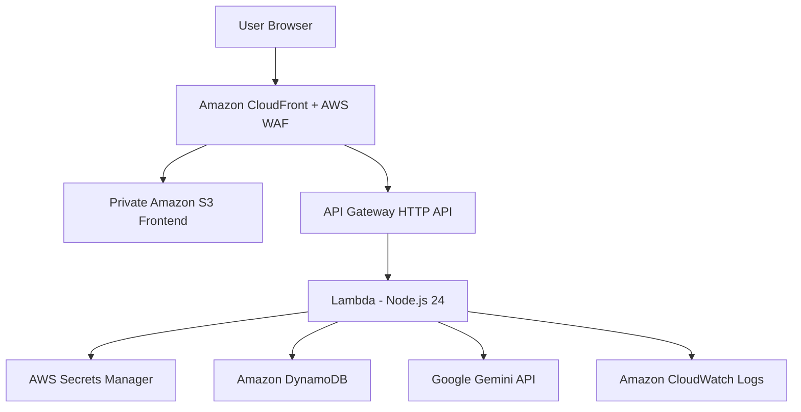

# Gemini Chatbot on AWS (ENTERPRISE AI CHATBOT)

A browser-based AI chatbot powered by Google Gemini and deployed on Amazon Web Services (AWS). The project demonstrates cloud infrastructure deployment, serverless application development, infrastructure as code, and security implementation.

## Project Overview

The goal was to build and deploy a working AI chatbot that users can access through a web browser.

The application uses Google's Gemini model to generate responses and AWS services to host, secure, and operate the application.

## Architecture



## Technology Stack

- **AI Model:** Google Gemini 3.5 Flash-Lite
- **Backend:** Node.js 24, Express
- **Frontend:** HTML, CSS, JavaScript
- **Cloud Platform:** Amazon Web Services
- **Compute:** AWS Lambda
- **API:** Amazon API Gateway
- **Storage and Hosting:** Amazon S3
- **Content Delivery:** Amazon CloudFront
- **Security:** AWS WAF, AWS Secrets Manager
- **Rate Limiting:** Amazon DynamoDB
- **Monitoring:** Amazon CloudWatch
- **Infrastructure as Code:** Terraform

## Security Features

- HTTPS delivery through CloudFront.
- AWS WAF managed rules for common web threats, SQL injection, and IP reputation.
- WAF rate-based protection.
- API Gateway throttling.
- Input validation and a 4,000-character message limit.
- Email and phone number redaction before sending prompts to Gemini.
- Gemini API key stored in AWS Secrets Manager.
- DynamoDB-based IP request limiting.
- CloudWatch logging with seven-day retention.

## API Endpoints

| Method | Endpoint | Purpose |
|---|---|---|
| GET | `/health` | Health check |
| POST | `/chat` | Submit a message to Gemini |

## Testing

The following application-level regression tests were completed:

- Empty messages rejected with HTTP 400.
- Messages exceeding 4,000 characters rejected with HTTP 400.
- Email addresses redacted.
- Phone numbers redacted.
- Normal chatbot requests successfully returned Gemini responses.
- Health endpoint previously verified successfully.

Note: Rate limiting and WAF protections were deployed, but a full load test and active WAF attack simulation were not performed.

## Project Structure

```text
gemini-chatbot/
├── public/
│   └── index.html
├── src/
│   └── server.js
├── terraform/
│   ├── main.tf
│   ├── frontend.tf
│   ├── rate_limit.tf
│   └── waf.tf
├── lambda-package/
├── .env.example
├── .gitignore
├── package.json
└── README.md
```

## Local Setup

1. Clone the repository.
2. Install dependencies:

   ```bash
   npm install
   ```

3. Create a `.env` file using `.env.example` as a template.
4. Add your own Gemini API key to `.env`.
5. Start the application using the configured start script:

   ```bash
   npm start
   ```

6. Open the local application in your browser.

## Deployment

The AWS infrastructure is managed using Terraform.

The deployment includes the frontend hosting, CloudFront distribution, API Gateway, Lambda function, Secrets Manager, DynamoDB, WAF, and CloudWatch resources.

Deployment requires an AWS account, configured AWS credentials, Terraform, and a Gemini API key stored securely in AWS Secrets Manager.

## Key Learning Outcomes

- Building and deploying a serverless AI application.
- Integrating a third-party generative AI API.
- Designing AWS cloud architecture.
- Using Terraform for infrastructure as code.
- Implementing input validation and privacy controls.
- Configuring AWS WAF and API throttling.
- Managing application secrets securely.
- Monitoring serverless applications with CloudWatch.
